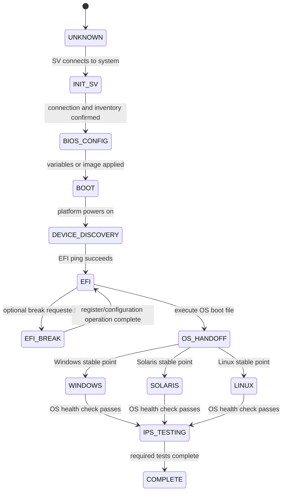
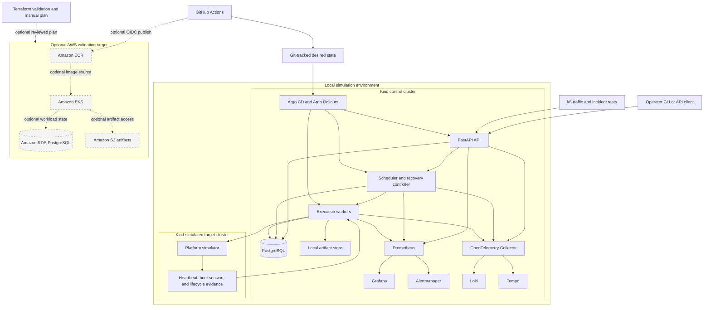
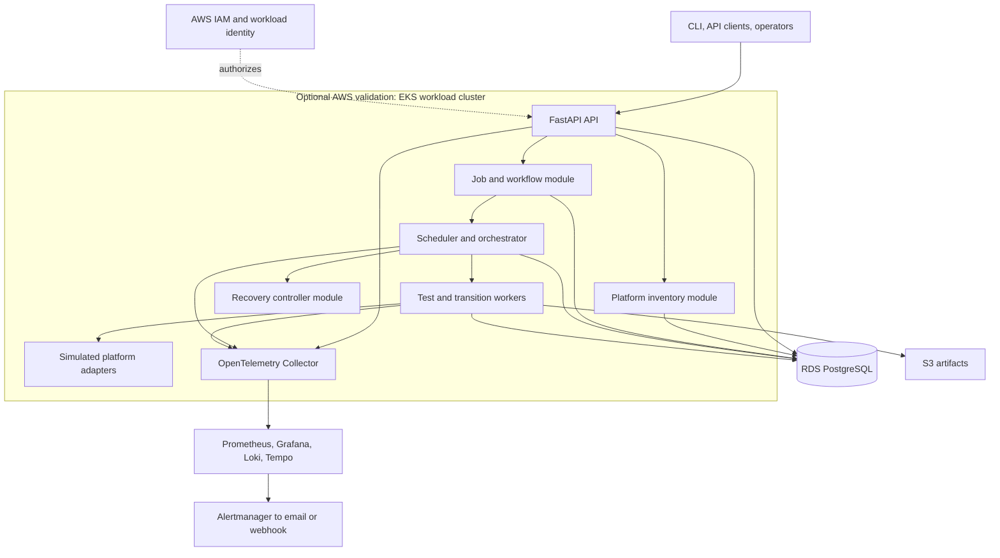

# SNTL — Platform Automation and Validation

Portfolio architecture and implementation roadmap. Prepared October 7, 2026.

## Purpose and scope

SNTL recreates the structure of a Python platform automation system with a small deterministic machine-state simulator, versioned test workflows, and production-style cloud operations. The hardware and stage-specific behavior is intentionally simulated; the portfolio focus is AWS architecture, Kubernetes, infrastructure as code, security, observability, resilience, and software delivery.

The first target is a reproducible local deployment. The second is an AWS environment that can be provisioned for a demonstration and removed afterward. The simulator is supporting evidence for the platform; it is not intended to reproduce proprietary SV, BIOS, EFI, firmware, or IPS implementations.

Suggested portfolio description: "SNTL is a Python platform automation and validation system with a simulated hardware lifecycle, durable workflow execution, Kubernetes deployment, Terraform-managed AWS infrastructure, and observable CI/CD."

## System boundaries and deliberate simulation boundary

- Control plane: FastAPI API, Python scheduler, PostgreSQL, workflow validation, platform inventory, audit history.
- Execution plane: Python worker processes with registered task handlers and a platform adapter interface.
- Simulated target: deterministic machine state including boot transitions, capabilities, delays, disconnections, and failures. It emits the same kinds of events and results that the cloud platform must operate on, without controlling real hardware.
- Operations: containers, Kubernetes, Terraform, metrics, structured logs, tracing, release automation, and recovery runbooks.

Linux containers host the simulator and orchestration services. Simulated EFI, Windows, Solaris, and Linux results are explicitly labeled. They do not prove actual firmware or OS execution. The simulator should be replaceable behind an adapter interface, but real hardware drivers, register access, BIOS images, operating-system boot hosts, and IPS algorithms are outside the portfolio scope.

The simulator should remain intentionally small: a state enum, scripted transitions, configurable latency, deterministic fault injection, and representative telemetry. Do not spend project time implementing firmware semantics. The goal is to create enough lifecycle traffic to demonstrate scheduling, persistence, deployment, recovery, dashboards, alerts, and release automation.

Keep `Init SV` as the original domain label until its exact meaning is defined. Model it as a replaceable initialization operation rather than guessing its implementation.

## Execution model

The system is a linear hardware bring-up pipeline followed by OS-specific validation. The platform is not a general-purpose workflow engine that can arbitrarily jump between boot states. A job selects a target platform, BIOS configuration, optional EFI-break actions, destination OS, and a sequence of IPS tests. The orchestration layer advances through the prescribed stages and records evidence at each boundary.

The core relationship is:

```text
Job request
  → SV initialization and connection
  → BIOS pre-configuration
  → platform power-on and device discovery
  → EFI reachability
  → optional EFI breaks and register writes
  → OS boot handoff (Windows, Solaris, or Linux)
  → stable OS health check
  → IPS tests, scripts, metrics, and artifacts
```

`Init SV` is the Python System Validation initialization package establishing and starting the connection to the system under test. The system under test is the physical platform: Xeon processor, CPU board, memory, power, firmware, storage, and other required hardware. In the portfolio implementation, this boundary is represented by a simulator adapter, while the connection lifecycle, timeout handling, logs, and state persistence remain real.

## Linear platform pipeline

### Platform boot state



The states are intentionally linear. A failed stage ends the job or sends it to an explicit recovery path; it does not silently skip forward. `EFI_BREAK` is a controlled intermediate state and may occur zero or more times according to the job definition. Register writes are represented as typed operations with address, width, value, mask, expected readback, and rollback/recovery behavior where supported.

`DEVICE_DISCOVERY` makes the BOOT responsibility explicit: powering on is not enough; the platform must enumerate the expected devices and record the inventory. `EFI` is reached through a pinging or reachability method that proves EFI can receive commands. `OS_HANDOFF` executes the boot file for the requested Windows, Solaris, or Linux target. A stable point means the OS-specific health check, agent, or command channel is available before IPS tests begin.

The original domain includes Solaris, so the portfolio model must retain it even if the initial simulator implements only representative Windows and Linux behavior. Solaris can begin as a black-box adapter with the same contract.

The IPS phase is where platform validation occurs. Example test families include RAM, voltage/frequency, compute, device, and custom scripts. Each test declares its required OS and capabilities, timeout, retry policy, command or adapter handler, metrics to collect, and artifacts to retain. The test result must distinguish assertion failure from infrastructure failure and include the measurement data used to make the decision.

Persist desired state and observed state separately. Requesting a boot does not mean the platform has booted. Accept an observed transition only after adapter confirmation. Persist transition requests, acknowledgements, timeouts, boot session IDs, and recovery actions. An uncertain target becomes UNKNOWN and requires reconciliation. Unreachable and quarantined are separate health conditions, not successful boot stages.

### Workflow and task execution state

`QUEUED -> RUNNING -> SUCCEEDED | FAILED | CANCELED`

Tasks additionally support `BLOCKED`, `RETRY_WAIT`, and `SKIPPED`. A task failure does not change the platform boot state by itself. A reboot changes the boot session and invalidates readiness observations from the previous session.

Cancellation stops new dispatch and requests cooperative cancellation of running work. A run becomes CANCELED only after running attempts terminate or their authority is revoked; record any uncertainty about physical side effects.

## Architecture



The control and target clusters become separate once failure-isolation exercises begin. The simulator may fail without taking down API, scheduling, recovery, or investigation services. The AWS region is a target design for later scoped validation; it is not part of daily local operation. See [Simulation environment guide](SIMULATION-ENVIRONMENT.md) and [CI/CD pipeline design](CI-CD-PIPELINE.md) for the operational and delivery details.

Start with one application repository and shared domain library, deployed as API, scheduler, and worker roles. Avoid separate services for each boot stage. Use PostgreSQL as both authoritative storage and the initial durable task queue, locally and in AWS. This keeps the first implementation small enough to explain and operate.

### Consistent logical and deployment views

The local and AWS diagrams describe the same system. They differ only in where
components run and which data services they use. SNTL has logical service
boundaries and deployment boundaries:

| Logical responsibility | Initial deployable unit | Optional later split | Local implementation | AWS target |
| --- | --- | --- | --- | --- |
| API, identity, job submission, workflow validation | API | API and identity service | Kind control cluster | EKS workload |
| Platform inventory | API module | Inventory service | API module with PostgreSQL | API module or EKS service with RDS |
| Job and workflow management | API module | Job/workflow service | API module with PostgreSQL | API module or EKS service with RDS |
| Scheduling and orchestration | Orchestrator | Scheduler service | Kind control cluster | EKS workload |
| Recovery decisions | Orchestrator module | Recovery controller | Orchestrator | Orchestrator or EKS service |
| Test and transition execution | Workers | Worker pool by capability | Kind control cluster | EKS worker deployment |
| Platform adapter and simulated target | Worker adapter plus simulator | Dedicated adapter service | Separate target Kind cluster | Worker-side adapter and selected target environment |
| Durable run state | PostgreSQL | PostgreSQL plus an optional dispatch extension | Local PostgreSQL | Private RDS PostgreSQL |
| Artifacts | Artifact adapter | Dedicated artifact service if needed | Local filesystem or MinIO | Private S3 |
| Telemetry and alerting | Observability stack | Managed AWS integrations if justified | OTel, Prometheus, Grafana, Loki, Tempo, Alertmanager | OTel and selected in-cluster or AWS backends |

The screenshot-style AWS view is therefore valid when its boxes are read as
logical responsibilities. It should not imply that every box must be a separate
deployment in the first release. The initial AWS deployment can run API,
orchestrator, and workers as three workloads while inventory, job management,
and recovery remain explicit modules with clear ownership boundaries.

### AWS target view

This view uses the same responsibilities as the local diagram and replaces the
local services with their AWS target equivalents. EKS is the Kubernetes
workload platform; the managed EKS control plane is not where application
services execute.



The local diagram is the daily operating view; this AWS view is the optional
cloud-validation view. Both preserve the same workflow state, lease, adapter,
recovery, telemetry, artifact, and audit contracts.

Workers claim eligible tasks in short transactions using row locks, persist an attempt, then execute outside the transaction. Claims expire and are renewed by heartbeats. Do not hold a database transaction open during a test or reboot.

If queue throughput later warrants SQS, add it behind a dispatch interface with a transactional outbox. Treat messages as delivery hints; the database still decides whether a task is eligible. A separate queue is an extension, not an MVP dependency.

## Domain model

| Entity | Responsibility |
| --- | --- |
| Platform | Identity, capabilities, desired/observed boot state, boot session, health |
| Platform lease | Exclusive owner, expiry, monotonically increasing fencing token |
| Workflow version | Immutable validated definition, content digest, handler versions |
| Run | Pinned workflow version, platform, status, requested parameters |
| Task instance | Dependencies, required environment, timeout, retry policy, status |
| Task attempt | Worker, lease token, start/end, heartbeat, result and error classification |
| Transition event | Requested/observed state, boot session, time and reason |
| Artifact | Run/attempt reference, storage key, checksum, size, retention metadata |
| Audit event | Actor, operation, resource, timestamp, outcome |

Use PostgreSQL constraints and transactions to enforce ownership and allowed execution changes. Keep migration scripts under version control. Store result summaries and artifact metadata in PostgreSQL; store large logs and reports outside the database.

## Workflow definitions

Use versioned YAML validated against a schema. The first schema should model a linear pipeline with explicit stage groups: `sv_init`, `bios_config`, `boot`, `efi`, `efi_breaks`, `os_handoff`, `os_health`, and `ips_tests`. Later, individual IPS tests may have dependencies, but the platform stages remain ordered. Resolve task types through an allowlisted Python registry. Definitions supply validated parameters; they cannot submit arbitrary shell commands or import arbitrary modules.

Illustrative definition, not executable code:

```yaml
name: linux-boot-smoke
version: 1
target:
  os: linux
  capabilities: [efi, linux, ips]
steps:
  - id: initialize
    type: platform.initialize
    timeout_seconds: 30
  - id: configure_bios
    type: platform.configure_bios
    depends_on: [initialize]
    requires_state: INIT_SV
    timeout_seconds: 30
  - id: power_on_and_discover
    type: platform.boot_and_discover_devices
    depends_on: [configure_bios]
    requires_state: BIOS_CONFIG
    expected_devices: [cpu, memory, storage, network]
    timeout_seconds: 120
  - id: reach_efi
    type: platform.boot_to_efi
    depends_on: [power_on_and_discover]
    requires_state: DEVICE_DISCOVERY
    timeout_seconds: 60
  - id: efi_smoke
    type: smoke.efi
    depends_on: [reach_efi]
    requires_state: EFI
    timeout_seconds: 20
  - id: boot_linux
    type: platform.execute_os_boot_file
    depends_on: [efi_smoke]
    requires_state: EFI
    os: linux
    timeout_seconds: 90
  - id: linux_smoke
    type: smoke.linux
    depends_on: [boot_linux]
    requires_state: LINUX
    timeout_seconds: 30
    retry:
      max_attempts: 2
      retryable_errors: [temporary_agent_unavailable]
  - id: ram_stress
    type: ips.ram
    depends_on: [linux_smoke]
    requires_state: LINUX
    timeout_seconds: 300
    metrics: [memory_errors, bandwidth, duration]
  - id: voltage_frequency
    type: ips.voltage_frequency
    depends_on: [ram_stress]
    requires_state: LINUX
    timeout_seconds: 300
    metrics: [voltage, frequency, throttling, temperature]
  - id: compute_validation
    type: ips.compute
    depends_on: [voltage_frequency]
    requires_state: LINUX
    timeout_seconds: 300
    metrics: [throughput, errors, temperature]
```

BIOS configuration may use individual variables or a preset/custom BIOS image; the job records which configuration was selected and its digest. Boot and device discovery records expected versus observed devices. EFI-break operations can write registers and verify readback. The OS boot stage selects a boot file based on `target.os`. Provide separate Windows, Solaris, Linux, and EFI-only workflow examples, but keep the same stage contract.

Adapter operations return structured acknowledgements, observations, and errors. Smoke tasks produce a result and a small JSON/JUnit artifact. Simulator scenarios use fixed seeds or scripted outcomes so CI can reproduce a fault reliably.

## Reliability contract

- One active mutating workflow per platform. Independent platforms can execute concurrently.
- Task execution is at least once. Idempotency keys prevent duplicate submissions; attempt records deduplicate accepted results.
- Lease expiry permits recovery; fencing tokens reject writes and results from an obsolete worker. The adapter also enforces fencing before mutating simulated hardware. Real adapters must offer equivalent protection or require reconciliation before takeover.
- Hardware operations are not blindly retried. After a lost acknowledgement, inspect observed state and operation ID before deciding whether to repeat the action.
- Timeout, task assertion failure, transient connectivity failure, and invalid transition are different error classes. Only explicitly retryable errors get bounded retries with backoff.
- Persist progress before dispatch. A scheduler restart reconstructs runnable work from the database.
- Dependency failures block or skip descendants according to a documented policy. A run cannot succeed if a required task failed.
- API request idempotency, optimistic version checks, and database constraints prevent conflicting updates.
- Artifact uploads use stable attempt-specific keys and checksums. Mark artifacts available only after successful upload; reconcile uploads interrupted before metadata finalization.

## Local and AWS environments

| Concern | Local first | Temporary AWS demo |
| --- | --- | --- |
| Runtime | Docker Compose, then kind | EKS with managed node group |
| Database | PostgreSQL container | Private RDS PostgreSQL |
| Artifacts | Filesystem adapter | Private S3 bucket |
| Images | Local builds and kind image loading | ECR images pinned by digest |
| Configuration | Environment config; ignored local secrets | Secrets Manager and workload identity |
| Deployment | Helm chart | Same chart, environment-specific values |
| Infrastructure | Compose/kind configuration | Terraform modules and demo root |
| Access | localhost or port-forward | Restricted cluster access and port-forward initially |
| Observability | Optional Compose/kind profile | Bounded in-cluster stack for demo |

Keep RDS outside Kubernetes in AWS. A PostgreSQL StatefulSet is acceptable for the disposable local environment. Use persistent storage locally when demonstrating restart recovery.

## AWS architecture evaluation

The architecture should be selected against four requirements: demonstrate Kubernetes and DevOps capability, keep the simulator and control plane reliable, avoid unnecessary custom infrastructure, and allow the AWS environment to be created temporarily at reasonable cost.

### Candidate A: EKS plus managed data services — recommended

Run the API, scheduler, workers, and observability components on EKS. Use RDS PostgreSQL for durable state, S3 for artifacts, ECR for images, and Secrets Manager for credentials. Use SQS only if dispatch volume or decoupling requirements justify it; PostgreSQL-backed claiming is adequate for the first slice.

This best matches the stated portfolio goal because it demonstrates Kubernetes deployment, pod security, workload identity, Helm, GitOps, autoscaling, probes, disruption behavior, and observability. It also keeps the highest-risk stateful services managed by AWS.

The main tradeoff is cost and operational surface. EKS adds a cluster fee and worker, networking, logging, and storage costs. A temporary demo should use a small cluster, a single-AZ RDS configuration, bounded observability retention, and port-forwarding instead of a public load balancer where practical.

### Candidate B: ECS Fargate plus managed data services

Run the same containers as ECS services and tasks, with RDS, S3, ECR, and Secrets Manager. This is simpler and usually cheaper to operate for a small workload. It demonstrates containers, IAM, networking, deployment automation, and managed AWS services.

It is a good implementation alternative if the portfolio objective is AWS application delivery. It is weaker if Kubernetes is a central skill signal, because the project would not demonstrate Kubernetes scheduling, Helm, GitOps, or pod-level controls.

### Candidate C: EKS with in-cluster PostgreSQL and observability

Run nearly everything inside EKS using StatefulSets and persistent volumes. This creates more Kubernetes material but increases backup, upgrade, failure, and data-protection responsibilities. It is not appropriate for the primary AWS design because managed RDS and S3 provide stronger evidence of sound service boundaries.

### Recommended boundary

```text
GitHub Actions + OIDC
          │ build, scan, sign, publish
          ▼
        ECR ───────────────► EKS
                              │ API / scheduler / workers
                              │
                    ┌─────────┼─────────┐
                    ▼         ▼         ▼
                  RDS       S3      Secrets Manager
               run state  artifacts  credentials
```

Use EKS for stateless orchestration workloads and managed AWS services for durable data and secrets. The simulator runs as a worker-side adapter. A single EKS cluster is sufficient for the demo; separate production clusters, multi-account topology, and multi-region recovery are outside the initial scope.

### Decision criteria and validation

Before implementation, record an ADR with weighted criteria: Kubernetes evidence, monthly demo cost, operational complexity, durability, security boundaries, deployment repeatability, and teardown reliability. Prototype the same API and worker container on both kind and EKS. Validate that the recommended design can:

- create and destroy the environment from Terraform;
- deploy an immutable image through the CI/CD path;
- survive a worker restart without losing or duplicating a run result;
- persist run state through pod replacement;
- store and retrieve artifacts privately;
- expose correlated logs, metrics, and traces;
- restrict AWS access by workload and repository;
- operate without a public endpoint during the first demo; and
- produce a clear cost and retained-resource report after teardown.

If Kubernetes is not a required portfolio signal, choose ECS Fargate instead. If it is required, EKS plus RDS, S3, ECR, and Secrets Manager is the most defensible architecture for this project.

AWS design: VPC, private worker and database subnets, security groups, EKS, ECR, RDS, S3, Secrets Manager, IAM roles, and budget alerts. Explicitly choose and price outbound networking: NAT gateways and VPC endpoints have different cost profiles. Initially use port-forwarding so a public application load balancer, DNS, and certificate are optional extensions. Ensure there is a documented path to the restricted EKS endpoint for the operator.

For a disposable cloud profile, a small single-AZ database is a documented availability tradeoff. A later production design can add multi-AZ database availability, node distribution, and tested backups. Do not claim high availability for the initial demo.

Use separate Terraform bootstrap and environment roots. Bootstrap state storage has an intentional longer lifecycle than demo compute. Keep secrets out of Terraform values and outputs wherever possible and protect remote state access.

## Observability

Use structured JSON logs with run_id, task_id, attempt_id, platform_id, boot_session_id, and trace_id. Keep these identifiers in logs and traces, not unbounded metric labels.

Instrument Python with OpenTelemetry. Use Prometheus and Grafana for metrics, Loki for logs, and Tempo for traces, enabled incrementally to fit local resources. Set explicit retention and storage limits. Trace task attempts and transitions; use trace links across asynchronous boundaries.

Dashboards: oldest queued task age, active workers, stale heartbeats, task outcome rates, task duration by type, boot transition duration, retries, and database connection saturation. Distinguish expected test failures from failures of the orchestration service.

Initial alerts: queued work with no healthy workers, rising queue age, repeated boot timeouts, and database unavailability. Document threshold rationale. Measure a proposed healthy-simulator objective such as 95% of eligible tasks starting within 10 seconds under a defined load; publish actual results before claiming an achieved SLO.

## Security and software delivery

- Authenticate write operations; add viewer/operator/admin authorization and actor-attributed audit records. A local demo token can precede OIDC integration, with its limitation documented.
- Keep database and artifacts private, encrypt traffic and stored data, and apply lifecycle/retention policies.
- Run pods as non-root, drop capabilities, use seccomp, and prefer read-only root filesystems with explicit writable scratch mounts.
- Configure resource requests/limits, readiness/liveness probes, graceful termination, and narrow service accounts.
- Use NetworkPolicies with a network implementation that enforces them; verify actual denied traffic, rather than only checking manifests.
- Scope each workload's AWS permissions. Use EKS Pod Identity for S3/secret access where applicable.
- Use GitHub Actions OIDC for AWS release/infrastructure operations; constrain the trust policy to the intended repository and environment.
- Pin dependencies and action revisions; scan images, dependencies, Terraform, and Kubernetes manifests. Emit an SBOM and define how findings are reviewed.

Pull-request CI runs Actionlint, Gitleaks, lint/type checks, domain tests, PostgreSQL integration tests when available, container build, manifest rendering, Terraform formatting and credential-free static validation, TFLint, Checkov, and SonarQube after its trusted credentials and Quality Gate are configured. Add an ephemeral Kind smoke deployment when the chart exists. See [CI/CD pipeline design](CI-CD-PIPELINE.md) for the required checks and implementation order.

Release builds one traceable immutable artifact and promotes the same digest through local `dev`, `staging`, and `production` simulation environments. Local development may use Kind-loaded images or a local registry. ECR publication, digest recording, Cosign signing, and SBOM attestation are optional protected-environment capabilities, not prerequisites for local CD. Argo CD running inside the demo cluster observes the Git-tracked desired state, avoiding a requirement for hosted runners to access a private cluster endpoint. Bootstrap Argo CD from an authorized operator context.

Separate application release automation from Terraform provisioning. Pull requests perform Terraform static checks without AWS access. An authenticated Terraform plan is a manually dispatched, OIDC-protected workflow after the AWS target and remote state exist; apply remains a separately approved future operation. Scope deployment roles separately from infrastructure roles. Use a one-shot migration job and backward-compatible schema changes; reverting an image does not automatically reverse a database migration.

## Implementation milestones and acceptance criteria

### 1. Minimal simulator and cloud-facing contract

Implement only the machine-state enum, adapter protocol, workflow schema, event/result model, and deterministic fault scenarios. Include representative transitions for SV initialization, BIOS configuration, BOOT/device discovery, EFI, EFI breaks, OS handoff, OS stable, and IPS testing.

Done when a run produces realistic state events, structured logs, metrics, and artifacts for EFI, Linux, Windows, and Solaris scenarios. The simulator does not need to model real hardware behavior.

### 2. Durable local platform

Add FastAPI, PostgreSQL migrations, run submission/status APIs, scheduler, worker claims/leases, attempts, cancellation, and artifacts. Package in Docker Compose. Prefer an API and CLI initially; add a small dashboard after the execution contract works.

Done when concurrent runs on different platforms work, two runs cannot own the same platform, duplicate submissions are deduplicated, and killing a worker produces bounded recovery without accepting stale results.

### 3. Local Kubernetes and observability

Create a Helm chart and kind workflow. Add probes, resources, workload security settings, graceful shutdown, metrics, logs, traces, and dashboards.

Done when the same demo runs on kind; a worker pod restart is recoverable; a task can be followed across logs and traces; and an induced worker outage raises the intended alert.

### 4. CI/CD, local CD, and supply-chain evidence

Add pre-commit hooks; GitHub pull-request validation for Actionlint, Gitleaks, Python quality, Terraform formatting/validation, TFLint, Checkov, and later Helm/Kustomize rendering; SonarQube coverage and Quality Gate after trusted configuration exists; container build, Trivy, SBOM evidence, local release manifests, and GitOps delivery. Test schema migration and rollback behavior. Keep all cloud mutation disabled.

Done when local hooks and CI independently reject a meaningful regression, a commit produces a traceable immutable artifact and retained quality evidence, a digest is promoted through the local environments, and a degraded release can be halted or restored from Git.

### 5. Terraform-managed AWS target and optional cloud validation

Add Terraform for remote state bootstrap, VPC, EKS, ECR, RDS, S3, Secrets Manager, IAM/OIDC, environment configuration, budget alerts, cost notes, and teardown scripts. Validate the design through formatting, `init -backend=false`, validation, TFLint, Checkov, and reviewed plans without deploying it. Reuse the existing Helm chart and keep costly resources disabled by default.

Done when the AWS target design produces reviewed static-validation evidence and a manual plan artifact without automatic apply. A later explicitly approved cloud exercise may provision only the capability under test, run the demo, retrieve artifacts, and remove the resources. Teardown verification includes load balancers, volumes, log storage, database snapshots, and versioned S3 objects according to the retention choice, with deliberately retained state, images, or backups reported.

### 6. Portfolio evidence and operational exercises

Publish an architecture diagram, API examples, screenshots, short demo recording, ADRs, runbooks, measured k6 results, dashboard and trace evidence, and incident reports for database, worker, network, reboot, and release failures.

Done when another person can run the local demo from the README, reproduce a documented incident, follow the evidence to the diagnosis, and understand both the simulated boundary and the optional cloud engineering design.

Milestones are ordered by dependency rather than calendar estimates. Estimate effort after the first durable vertical slice establishes implementation pace.

## Interview demonstration

1. Submit EFI-only, Linux, and Windows simulated runs against separate platforms.
2. Show environment guards rejecting a Linux task on an EFI-only target.
3. Follow a successful run through boot transitions, attempts, metrics, traces, and artifacts.
4. Inject a retryable connection failure and show bounded recovery.
5. Kill a worker mid-run and show lease expiry, reconciliation, and stale-result rejection.
6. Inject a BIOS/boot failure and show blocked descendants and an operational alert.
7. Deploy a new image and demonstrate a compatible rollback.
8. Show the Terraform plan, identity boundaries, cost breakdown, and teardown evidence.

Report measured throughput, recovery latency, queue-start latency, deployment time, recovery behavior, and provisioning time with test conditions. Keep simulated test assertion failures separate from orchestration reliability statistics.

## Suggested repository layout

```text
sntl-automation-platform/
  README.md
  ARCHITECTURE-AND-ROADMAP.md
  pyproject.toml
  src/test_platform/{api,domain,scheduler,worker,adapters,telemetry}/
  migrations/
  workflows/{efi-smoke,linux-smoke,windows-smoke}.yaml
  tests/{unit,integration,recovery}/
  deploy/{compose,helm,kind}/
  infra/{bootstrap,modules,environments/demo}/
  observability/{dashboards,alerts}/
  docs/{adr,runbooks,demo}/
  scripts/
  .github/workflows/
```

## Cost and scope decisions

Develop locally and deploy AWS for scheduled demonstrations. At the currently published standard-support EKS rate of $0.10 per cluster-hour, 24 hours costs $2.40 and 730 hours costs $73 for the control plane alone. Workers, RDS, network services, storage, public IPv4, and telemetry add charges. Extended-support clusters have a higher rate. Recheck pricing and support status before deploying; no total environment estimate is established yet.

Start with a Python scheduler to demonstrate the original domain while keeping the simulator thin. Record an ADR comparing it with Temporal or AWS Step Functions and explaining the portfolio scope. The central engineering evidence should be the AWS and DevOps lifecycle: Terraform, EKS, IAM, GitHub OIDC, image supply chain, Helm/GitOps, observability, recovery, cost controls, and teardown.

Defer real hardware drivers, BIOS images, register programming, actual Windows/Solaris hosts, real EFI execution, IPS algorithm development, multi-region failover, a service mesh, arbitrary user code execution, and multiple message brokers. Add them only when a concrete scenario justifies the operational cost.

## Reference documentation

- [Amazon EKS pricing](https://aws.amazon.com/eks/pricing/)
- [EKS Pod Identity](https://docs.aws.amazon.com/eks/latest/userguide/pod-identities.html)
- [EKS identity and access management best practices](https://docs.aws.amazon.com/eks/latest/best-practices/identity-and-access-management.html)
- [GitHub Actions OIDC with AWS](https://docs.github.com/en/actions/how-tos/secure-your-work/security-harden-deployments/oidc-in-aws)

These references support pricing and identity choices. The application model, milestones, and implementation tradeoffs above are proposed design decisions.

