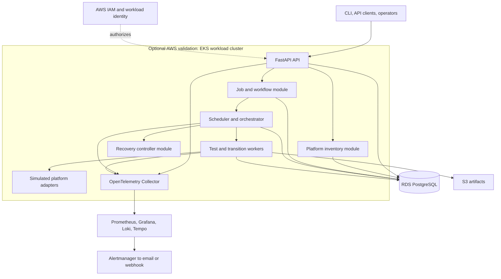

# SNTL optional AWS architecture

This is the cloud-validation target. It reuses the same SNTL service contracts
as the local platform while replacing local data and artifact adapters with
managed AWS services. It is designed in Terraform and remains unapplied during
normal local development.

The initial AWS deployment can use three workloads—API, orchestrator, and
workers—with inventory, job management, and recovery kept as modules. Those
modules may split into services later when independent scaling or failure
isolation justifies it. EKS is the workload platform; the managed EKS control
plane is not where application services execute.

## Local-to-AWS mapping

| Local | AWS target |
| --- | --- |
| Kind control cluster | EKS workload cluster |
| Kind simulated target cluster | Worker-side adapters and selected target environment |
| PostgreSQL | Private RDS PostgreSQL |
| Local filesystem or MinIO | Private S3 bucket |
| Local images or registry | ECR image digests |
| Kubernetes Secrets | Secrets Manager and workload identity where required |
| OTel, Prometheus, Grafana, Loki, Tempo, Alertmanager | Same in-cluster stack or selected AWS integrations |

See [architecture and roadmap](ARCHITECTURE-AND-ROADMAP.md) for the shared
logical boundaries and deployment reconciliation.
