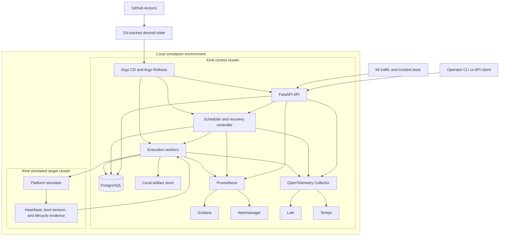

# SNTL local simulation architecture

This is the daily development and operations environment. Kind hosts the SNTL
control plane and a separate Kind cluster hosts simulated targets once failure
isolation exercises begin.

The target cluster may experience freezes, reboots, network failures, or node
loss while the control cluster remains available for scheduling, recovery, and
investigation.
