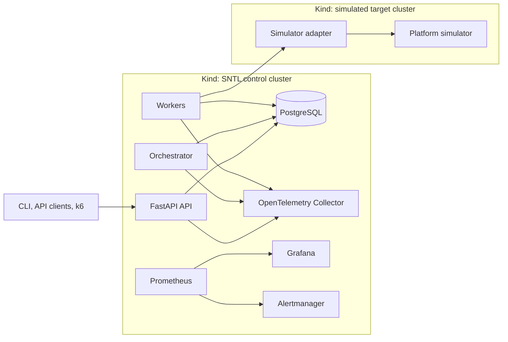

# Local-first implementation plan

## Outcome

Build and operate a complete SNTL control plane on Kind. Demonstrate that it remains observable and recoverable under realistic target failures, traffic changes, and infrastructure disruptions. AWS Terraform describes the later production-like topology but is not applied during normal development.

## Platform shape

Begin with one Kind cluster while the API and domain model are being built. Introduce a separate target Kind cluster before testing target-node outages, network partitions, and independent target failure recovery.



Prometheus receives bounded operational metrics. The OpenTelemetry Collector receives application traces and logs, routing them to the chosen local trace and log backends. Grafana is the investigation surface; Alertmanager provides the notification path.

## Build sequence

### 1. Durable workflow slice

Implement a single Linux workflow through a deterministic simulator:

```text
queued -> lease platform -> initialize -> configure -> boot -> EFI
-> Linux handoff -> Linux health -> one validation test -> complete
```

Add PostgreSQL migrations, idempotent job submission, task claiming, attempts, lease renewal, boot-session recording, and artifact metadata. Build this as API, orchestrator, and worker roles from a shared Python domain package.

### 2. Recovery slice

Script deterministic simulator scenarios for an expected reboot, unexpected reboot, timeout, target freeze, lost connectivity, device-discovery failure, and state mismatch. Implement evidence capture, recovery classification, bounded actions, reconciliation, and quarantine. Verify that an obsolete worker cannot write a result after its lease fencing token is revoked.

### 3. Observability slice

Instrument API, orchestrator, workers, and simulator adapters with OpenTelemetry. Create dashboards and alert rules for:

- API error rate and request latency.
- Queue wait time and task-claim delay.
- Active, expired, and conflicted platform leases.
- Stage and boot duration.
- Target heartbeat loss, unexpected reboots, and recovery attempts.
- Recovery exhaustion, quarantined platforms, and failed jobs.

Trace a submitted job from API request to worker execution, simulator observation, artifact write, and recovery branch. Test each alert through a controlled fault; an alert that has never fired is not accepted as evidence.

### 4. Traffic and resilience slice

Use k6 to submit and inspect realistic mixes of low-priority, scheduled, and enforced-priority jobs. Establish a baseline before increasing traffic. Use thresholds for whole-test pass/fail conditions and treat checks as request-level observations.

Run at least these investigations:

| Exercise | Controlled cause | Evidence and expected behavior |
| --- | --- | --- |
| API overload | k6 request-rate increase | latency/error alerts; queue pressure visible; recovery after load drops |
| Database contention | constrained connections or injected slow query | trace identifies DB latency; queue/worker effects measured |
| CPU throttling | constrained CPU limit under load | CPU throttling and p95 latency visible; capacity policy assessed |
| Target network failure | deny rule, delay, packet loss, or DNS failure | target classified unreachable; unsafe dispatch stops; recovery follows policy |
| Target freeze | simulator stops heartbeat | evidence retained; bounded recovery or quarantine |
| Unexpected reboot | simulator increments boot session | incident classified separately; stale readiness revoked; reconciliation occurs |
| Worker loss | delete a worker pod during operation | lease expiry/reconciliation prevents duplicate accepted results |
| Bad release | controlled broken configuration or API behavior | rollout health degrades; release is halted or rolled back |

Each exercise must document the initial symptom, alert, dashboard/traces/logs used, root cause, mitigation, recovery time, and preventive change.

### 5. Kubernetes operating model

Package the control-plane roles and simulator with Helm once the runtime contract is stable. Add health probes, resource requests and limits, RBAC, NetworkPolicies, secrets, graceful shutdown, and disruption behavior. Use Argo CD and Argo Rollouts only after the base deployment has a meaningful health signal that can drive safe progressive delivery.

### 6. AWS architecture implementation

Write Terraform for the target environment: remote state, VPC, subnets, security groups, IAM/OIDC, ECR, S3 artifacts, RDS PostgreSQL, EKS, workload identities, and budgets. Run formatting, validation, policy checks, and reviewed plans. Keep costly resources disabled by default; do not apply them as part of local work.

When an AWS validation is intentionally scheduled, deploy the same container images and Helm chart with AWS values. Validate only the cloud-specific concerns: ECR access, RDS/S3 adapters, IAM permissions, private networking, operator access, and retained-resource teardown.

## Completion evidence

The local-first milestone is complete when SNTL can run a versioned workflow, survive worker replacement, detect a simulated unexpected reboot, retain its evidence, and execute a bounded recovery or quarantine decision while the control plane remains healthy. The incident must be traceable across metrics, logs, and traces and be reproducible through a documented scenario.
