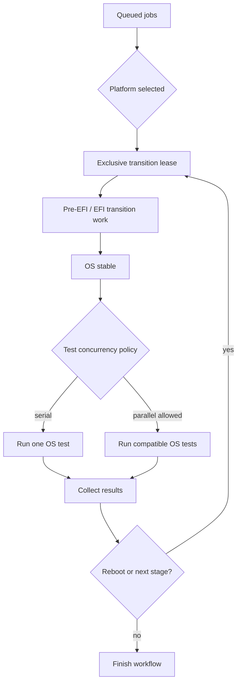
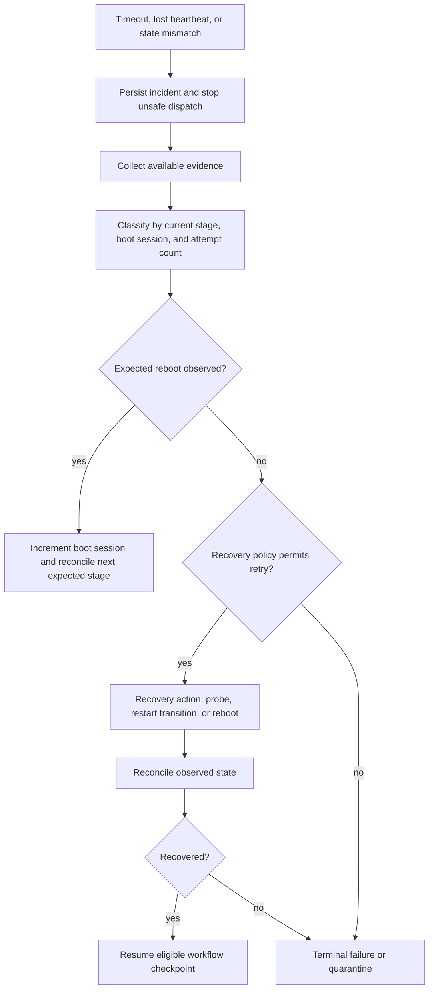

# SNTL system behavior

SNTL is a Python/FastAPI control plane for submitting, scheduling, observing, and recovering hardware-validation jobs. Enterprise hardware tools are represented by black-box adapters. SNTL owns their sequencing, persistence, observability, and recovery; it does not recreate proprietary firmware or test implementations.

## What executes

A **test** is a script or symbolic adapter operation tied to exactly one execution environment: pre-EFI/boot, EFI, Windows, Linux, or Solaris. Examples include RAM-slot discovery, internal-register validation, performance execution, and telemetry collection.

A **workflow** is an ordered set of platform transitions and tests. It may use one environment or cross several, for example:

```text
BIOS configuration → EFI register task → Linux test → reboot
→ BIOS reconfiguration → EFI task → Windows test
```

A **job** is a submitted execution of a versioned workflow with a target platform, priority, and optional overrides such as BIOS image, configuration parameters, retry policy, and test parameters. Workflows and individual tests may also be queued or scheduled according to their configuration.

## Users and interfaces

SNTL exposes the same control-plane capabilities through a production Web UI, API, and CLI. The first implementation delivers FastAPI and a developer-oriented CLI; the Web UI follows after the core execution contract is stable.

| Role | Permitted responsibilities |
| --- | --- |
| Viewer | Inspect permitted jobs, platforms, logs, metrics, traces, and artifacts. |
| Engineer | Submit, schedule, cancel own authorized jobs, apply approved workflow versions, and save private workflow drafts. |
| Platform operator | Manage platform availability, enforce priority jobs, initiate approved recovery actions, acknowledge alerts, and quarantine/release platforms according to policy. |
| Administrator | Manage users, role bindings, authorization policy, platform registration, global retention/recovery settings, and break-glass access. |

Platform operator and administrator roles may be held by the same user in the small portfolio deployment. They remain distinct in RBAC because platform recovery is an operational action, while changing identities, permissions, global policy, or break-glass access is a higher-impact administrative action. Separate roles provide least privilege, clearer audit records, and a credible path to separation of duties in a larger deployment.

## Platform inventory and workflow versions

The first version uses simulated platforms. Each platform has immutable or administrator-managed capability labels:

```text
efi/baremetal
linux-supported
windows-supported
solaris-supported
thermal-control-supported
```

The scheduler matches workflow requirements against these labels before assigning a platform. Jobs that require an unavailable capability remain queued or are rejected with a clear scheduling reason.

Test suites/workflows are versioned and Git-managed. Engineers may create or edit drafts through the Web UI or CLI and save private per-user versions. Publishing a shared workflow version requires generating a Git change, opening a pull request, and approval by the development owners. The scheduler runs only approved, immutable workflow versions; a job records the workflow version and content digest it used.

## Scheduling and priority

SNTL supports two user-selected priority modes:

| Mode | Behavior |
| --- | --- |
| Queue priority | Higher-priority jobs are selected before lower-priority waiting jobs. Running work is unaffected. |
| Enforced priority | A high-priority job takes ownership of the selected platform. SNTL stops the current job, records its checkpoint and partial evidence, returns it to the queue, and starts the enforced job. |

Enforcement is a controlled workflow transition, not an untracked process kill. The scheduler first requests cancellation, prevents new test dispatch, waits for the current operation's bounded cancellation window, records the platform's observed state, and then releases or transfers the lease. If the platform cannot be safely reconciled within policy, the enforcing job waits while recovery runs or the platform is quarantined.

The requeued job resumes only from an explicitly safe checkpoint after the platform's current state is reconciled. It must not assume that a BIOS, EFI, OS, or test operation was unchanged when preempted.

## Per-platform state

Each platform maintains separately persisted desired, observed, and execution state. These must never be conflated.

| State type | Purpose |
| --- | --- |
| Desired state | The next state requested by the workflow, such as EFI or Linux. |
| Observed state | What probes and adapters can currently verify. |
| Execution stage | The workflow checkpoint currently being processed. |
| Boot session | A monotonically increasing identity for a power-on/reboot cycle. |
| Health | Reachable, degraded, frozen, recovering, unavailable, or quarantined. |

The main stage grouping is `PRE_EFI`, `EFI`, and `OS`. More detailed state is tracked within each group:

```text
OFF
PRE_EFI: BIOS_IMAGE, BIOS_CONFIGURATION, BIOS_BREAK, POWER_ON, DEVICE_DISCOVERY
EFI: EFI_CONNECTING, EFI_STABLE, EFI_BREAK, EFI_TASKS
OS: OS_HANDOFF, OS_BOOTING, OS_STABILIZING, OS_STABLE, OS_TASKS
RECOVERING | FAILED | QUARANTINED
```

## Workflow and concurrency rules



- A platform has exclusive ownership during boot, pre-EFI, EFI, BIOS configuration, and reboot transitions.
- Multiple platforms can boot and test concurrently.
- Once an OS is stable, compatible tests may execute in parallel on that same platform only when the workflow explicitly allows it and the tests declare compatible resource requirements.
- Fine-grained same-platform test resource guardrails are deferred from the first implementation. The initial platform trusts engineers to configure compatible OS-level test concurrency; this limitation is documented rather than hidden.
- A reboot, BIOS operation, EFI operation, or transition out of a stable OS revokes OS-test authority and waits for compatible in-flight tasks to stop or time out.
- Platform ownership uses a renewable lease and fencing token so an obsolete worker cannot accept or write results after recovery has begun.

## Readiness and mismatch detection

Each environment has its own readiness evidence. The control plane evaluates evidence against the expected stage and treats disagreement as a first-class event.

| Stage | Example evidence | Mismatch example |
| --- | --- | --- |
| Pre-EFI/boot | platform power state, device discovery, readable boot-stage registers | workflow expects EFI but platform remains power-on or registers show an earlier stage |
| EFI | repeated successful EFI pings and command responses | EFI is expected but pings fail beyond the stabilization window |
| Windows | OS agent/service, required services, command execution, system telemetry | platform should be Windows but agent or health command is unavailable |
| Linux | SSH/test agent, required services, command execution, system telemetry | Linux is expected but no route, agent, or command response exists |
| Solaris | equivalent adapter-defined health checks | expected Solaris health evidence is absent |

Some signals are stage-bound. Boot/pre-EFI registers can be read only before BIOS takes over; their unavailability after that transition is expected, not automatically an error. The health-check contract must know the stage before classifying missing telemetry.

## Recovery model

Jobs and scripts can legitimately destabilize a target. SNTL must operate without required human intervention, retaining evidence before recovery or terminal failure.



Recovery is stage-specific and bounded:

- **Pre-EFI or EFI failure:** collect available register, BIOS, EFI, and boot evidence; retry probe or reboot according to policy.
- **OS failure/freeze:** collect agent, system, test stdout/stderr, and telemetry evidence; determine whether a reboot occurred; retry or reboot according to policy.
- **Unexpected reboot:** detect boot-session change, collect pre-reboot evidence where available, classify it separately from a planned workflow reboot, and reconcile the new stage.
- **Repeated failure:** stop after the policy's maximum attempts, capture the recovery assessment and Machine Check Architecture (MCA) evidence, mark the flow failed, and optionally quarantine the platform.

Available symbolic recovery actions are: wait and re-probe, soft reboot, hard power cycle, reset to a known BIOS image/configuration, and cooldown before retry. The recovery policy selects the permitted actions and maximum attempts for the stage and failure class.

Quarantine is conditional. A platform is quarantined and administrators are alerted when it cannot safely boot or recovery has determined it unsafe to reuse. Other terminal workflow failures preserve the assessment and return the platform to service only if the policy permits it.

Terminal failure never discards partial results. Independent test outcomes remain recorded even when a later transition or test fails.

## Result and incident classification

Tests and infrastructure incidents have separate statuses.

```text
Test: PASSED | FAILED_ASSERTION | SKIPPED | CANCELED

Execution: SUCCEEDED | TIMED_OUT | TARGET_UNREACHABLE | TARGET_FROZEN
           | EXPECTED_REBOOT | UNEXPECTED_REBOOT | STATE_MISMATCH
           | WORKER_LOST | RECOVERY_SUCCEEDED | RECOVERY_EXHAUSTED
           | QUARANTINED
```

One workflow may therefore be failed while preserving individual passed/failed test results, boot history, recovery attempts, and a final automated assessment for the user.

## Observability contract

Every log, trace, metric, artifact, and incident must be correlated with:

```text
job_id → workflow_run_id → platform_id → boot_session_id
      → stage_execution_id → test_id → attempt_id → trace_id
```

Required collected evidence includes:

- BIOS and EFI logs;
- test stdout and stderr;
- platform, hardware, and register telemetry available at the current stage;
- CPU frequency, voltage, temperatures, RAM and VRAM data;
- device discovery and boot timing;
- hardware-component error information and MCA records;
- workflow timeline, retries, state mismatches, and recovery decisions.

For the portfolio test environment, retain logs, traces, metrics, and workflow artifacts for one day. Apply explicit retention limits in the observability stack and S3 lifecycle configuration. Longer-term history is out of scope for the initial deployment.

Prometheus, Grafana, and OpenTelemetry are required components of the initial observability design. Alerts are delivered through Grafana/Alertmanager, email, and a webhook integration representing the production notification path.

## Network access

The initial AWS deployment has no public SNTL API endpoint. Operators and developers access the FastAPI service and observability interfaces through authenticated Kubernetes port-forwarding and restricted AWS/Kubernetes access. A public ingress, external DNS, and internet-facing load balancer are deferred until an explicit product requirement exists.

The system must record the point of failure: expected state, observed state, last successful check, boot session, failed operation, collected evidence, recovery actions, and terminal assessment.

## Portfolio implementation boundary

The simulator supplies deterministic representations of all adapter evidence, including normal execution, assertion failure, lost connectivity, freeze, expected reboot, unexpected reboot, device-discovery failure, and MCA data. The FastAPI service, database, workers, recovery controller, telemetry pipeline, Kubernetes deployment, Terraform, security controls, and CI/CD pipeline are real implementations.

